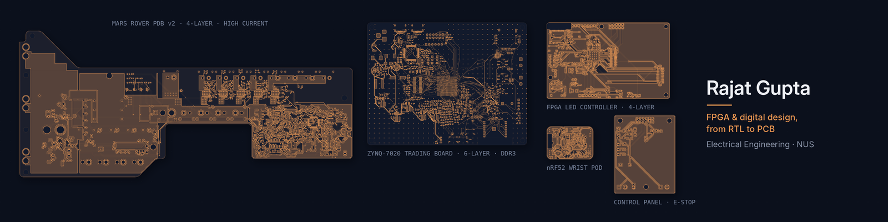
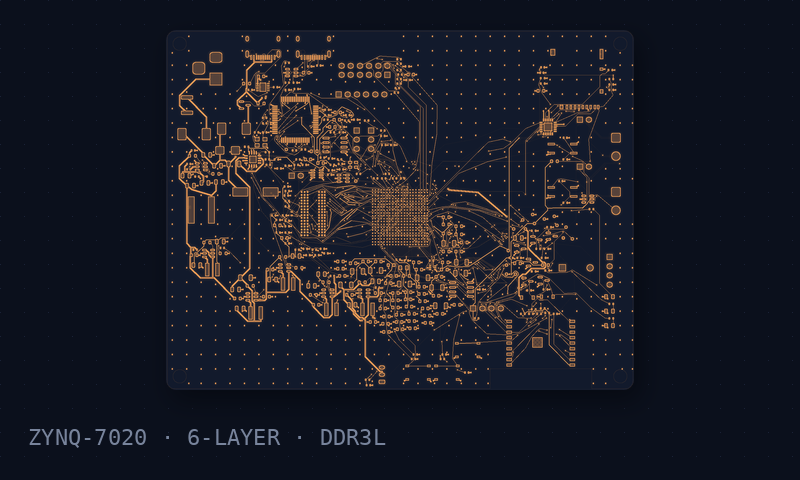
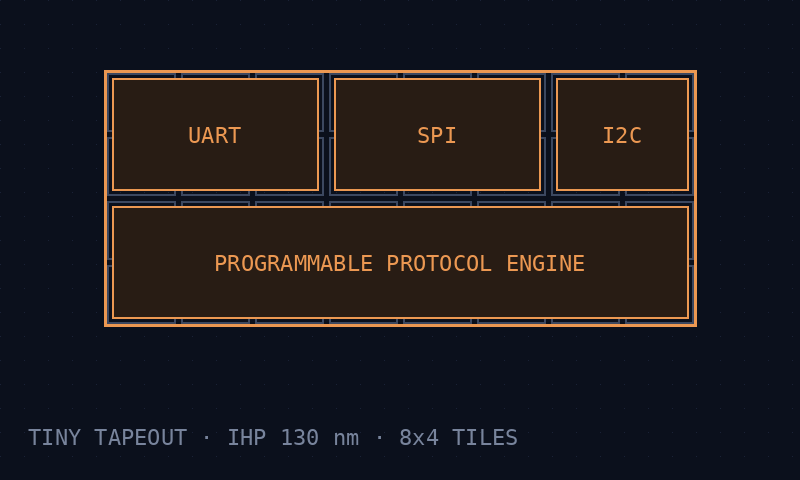
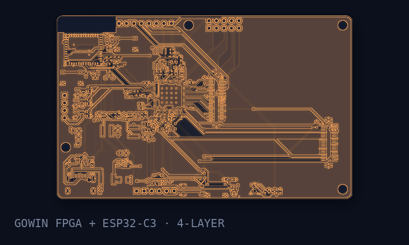
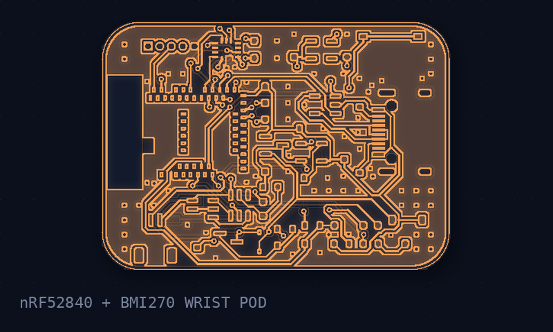
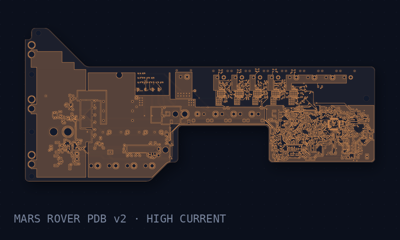
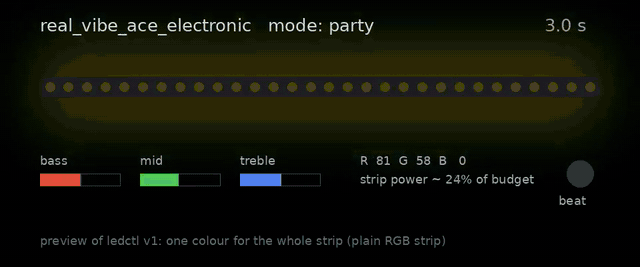

### FPGA & digital design, from RTL to PCB

Second-year Electrical Engineering student at NUS. I write Verilog, verify it bit for bit against a software golden model, and design the boards it runs on. Everything in the banner above is a real copper layer from a board I laid out.

[**Portfolio**](https://silverajat.github.io) · [LinkedIn](https://www.linkedin.com/in/rajat-gupta-ee) · [Email](mailto:rg192007@gmail.com) · Looking for summer 2027 internships in FPGA, digital design and verification

---

<table>
<tr>
<td width="50%" valign="top">

**Crypto order-flow engine + Zynq-7020 board** 
Verilog engine that rebuilds a live order book and computes trading signals in hardware, with a PicoRV32 control CPU and a hardware risk gate.

- **102,044 / 102,044** events of a 69-minute real market stream identical to the C++ reference
- Packet-to-features latency **p50 3.4 µs, p99 7.6 µs** after a tick-ladder book redesign
- Own **6-layer Zynq-7020 board** with DDR3L · RTL verified · board ordered
</td>
<td width="50%" valign="top">

**Protocol emulator ASIC** 
A small chip that can be reprogrammed after fabrication to speak UART, SPI and I2C. Entry for Jane Street's tapeout competition on Tiny Tapeout (IHP 130 nm).

- Prototyping the RTL on my own FPGA board against real sensor chips
- cocotb tests, gate-level simulation
- In progress · due Jan 2027
</td>
</tr>
<tr>
<td width="50%" valign="top">

**Music-sync LED controller** 
My own 4-layer board (Gowin GW2AR-18 FPGA + ESP32-C3) that lights a room in time with music.

- I2S mic input, 3-band filter bank and beat detector in Verilog
- Wrote a JTAG loader so the ESP32 configures the FPGA at boot when the flash programmer failed
- **Working** · moving the per-LED engine onto the FPGA
</td>
<td width="50%" valign="top">

**Lift tracker wearable** 
Wrist motion-sensor pod and Android app that count gym reps in real time.

- **32 of 33** recorded sets counted exactly, all within one rep
- Kotlin pipeline checked against a Python reference model in CI
- Custom 4-layer nRF52840 + BMI270 pod board · arriving soon
</td>
</tr>
</table>

**NUS Mars Rover · power distribution** 
Designed the rover's PDB v1, then PDB v2 end to end: a 4-layer high-current board with precharge, brake chopper, eFuse protection and hardware e-stop logic.

 

<b>LED controller demo</b> (preview of the lighting engine on a real song)

 

### Toolbox

**Digital design:** Verilog · cocotb · Vivado · Gowin EDA · Verilator · RISC-V (PicoRV32) · Tiny Tapeout 
**Hardware:** KiCad (4- and 6-layer) · DDR3L layout · power electronics · JLCPCB assembly · ESP32 · nRF52 
**Software:** Python · C / C++ · Kotlin · Git · Linux

**Earlier:** CHOMS coral-health monitor, Gold Medal and Best Project (1st of 77 teams) at JISF 2023 · VANDA International Science Competition, Gold (11th globally)
