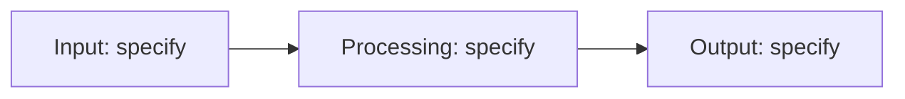

# <Project title>

<One-line summary: what it does and why.>

## Status

<Current state. Distinguish designed, implemented, simulated, assembled and measured.>

## Demo

<!-- Add a real project photo, GIF or video link when available. -->

## What it does

<!-- Replace with 3–5 implemented capabilities. Label planned capabilities explicitly. -->
- <Capability 1>
- <Capability 2>
- <Capability 3>

## Architecture

<!-- Replace these placeholder blocks with the actual architecture. -->


<Explain the blocks, interfaces, data flow and constraints.>

## Hardware

| Part | Role | Datasheet |
|---|---|---|
| <Actual part number> | <Role in this project> | <Manufacturer datasheet URL> |

<!-- For software-only work, state “Not applicable.” -->

## Repo layout

<!-- Replace this example with folders that actually exist. -->
```text
<repo>/
├── <folder>/    <What it contains>
└── README.md    Project documentation
```

## How to build and run

<!-- Add required hardware, exact tool versions, dependencies, wiring and tested commands. -->
<!-- Do not present untested commands as working instructions. -->
```text
<Exact setup command>
<Exact build command>
<Exact run or flash command>
```

## Verification / results

<!-- No measured results recorded yet. Replace only with real evidence. -->

| Test | Method / conditions | Expected | Measured result | Evidence |
|---|---|---|---|---|
| <Test> | <Setup and procedure> | <Criterion> | <Actual measurement> | <Log or plot path> |

<!-- Distinguish simulation from physical measurements; include units and limitations. -->

## What broke and what I learned

<!-- Add dated, factual entries. -->
- <YYYY-MM-DD> — <Failure, diagnosis, fix and lesson.>

## Roadmap

- [ ] <Next concrete step>
- [ ] <Next verification milestone>

## License

MIT. See `LICENSE`.
<!-- Add the full MIT LICENSE file before publishing. Confirm ownership and third-party licenses; do not license private team work without authorization. -->
